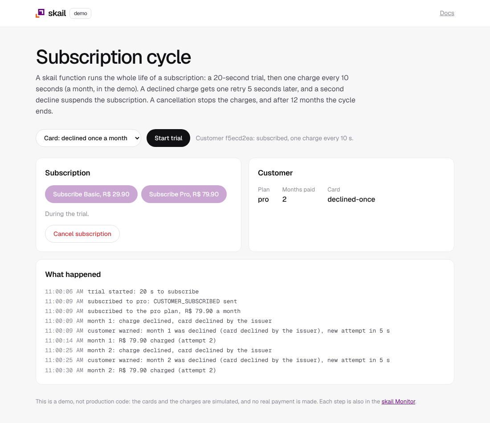

# skail subscription cycle (Node.js)

[Português (Brasil)](README.pt-BR.md)

An app with a skail function that runs the whole life of a subscription. The customer starts a trial, and the function waits for the trial deadline or for the customer to subscribe, whichever comes first. After the subscription it charges the plan once a month: a declined charge gets one retry, and a second decline suspends the subscription. A cancellation stops the charges, and after 12 months the cycle ends. The trial lasts 20 seconds and the month 10 seconds here; a real subscription uses 30 days and one month, with the same code. You play the customer on a page the app serves at http://localhost:8080.

It shows three skail features:

- **recurring billing**: a subscription is a loop that charges and waits for the next month;
- the **wait with a deadline**: the trial ends at the deadline or when the customer subscribes, whichever comes first;
- **hibernation and resume**: between charges the run holds no thread or process, so you can close the app and the months keep counting.

## Requirements

- One of: [Docker](https://docs.docker.com/get-docker/), [Podman](https://podman.io/docs/installation) or [Node.js](https://nodejs.org) 20.12 or newer. The run script uses the first one it finds.
- A skail environment with a workload registered for the `SKAIL_WORKLOAD` in `.env` (`subscriptioncycle:v1.0.0` by default). The [Quickstart](https://docs.skail.dev/comece-aqui/quickstart) shows how to create the account, the environment and the workload.

The project uses `@skail/runtime` and `@skail/build` **2.0.1-rc4**.

## Run

```bash
cp .env.example .env          # fill in SKAIL_SIDECAR, SKAIL_NAMESPACE and SKAIL_KEY (portal > Environments & keys > Connect)
scripts/run.sh                # then open http://localhost:8080
```

On Windows, in PowerShell: `copy .env.example .env`, then `powershell -ExecutionPolicy Bypass -File scripts\run.ps1` with the same arguments. The script works on the Windows PowerShell built into Windows; PowerShell 7 is not needed.

The script runs the demo with what the machine has: Docker, then Podman, then Node.js. If it finds none of them, it says what to install. Without the script, the commands are `npm install`, `npm run build` and `npm start` (with the arguments after `--`, as in `npm start -- <argument>`).



Each step the commands take shows up on the page, under **What happened**, and in the console. The buttons send the events to the run, and the page refreshes itself every second.

## The paths

| Card and what you click | What happens | Result |
|---|---|---|
| **Start trial**, then nothing | the trial ends at the deadline and nothing is charged | `trial ended` |
| `approved`, **Subscribe** | one charge per month, up to month 12 | `cycle ended` |
| `approved`, **Subscribe**, then **Cancel subscription** | the charges stop, and the months already paid stay paid | `cancelled` |
| `declined once a month`, **Subscribe** | every month the first attempt is declined, the customer is warned and the retry 5 seconds later is approved | the cycle goes on |
| `always declined`, **Subscribe** | month 1 is declined twice | `suspended` |

With `declined-once`:

```text
[c914edc4] month 1: charge declined, card declined by the issuer
[c914edc4] customer warned: month 1 was declined (card declined by the issuer), new attempt in 5 s
[c914edc4] month 1: R$ 29.90 charged (attempt 2)
```

## How it works

The app does three jobs in one process: it serves the page, it hosts the worker that runs the function (`createSkailPlatform`, with the bundle built by `npm run build`), and it starts the customer with the chosen card and turns the buttons into the subscription and cancellation events, through the skail HTTP API. The commands report each step to a timeline the page shows (over local HTTP, because the commands run in an isolated VM):

```http
POST {SKAIL_SIDECAR}/api/v1/trigger/subscriptioncycle/v1.0.0/ManageSubscription/{customerId}
["{customerId}", 20, 10]

POST {SKAIL_SIDECAR}/api/v1/fire/CUSTOMER_SUBSCRIBED/{customerId}
{"plan": "pro", "at": "2026-11-18T14:42:05.000Z"}

POST {SKAIL_SIDECAR}/api/v1/fire/SUBSCRIPTION_CANCELLED/{customerId}
{"reason": "cancelled in the demo", "at": "2026-11-18T14:42:38.000Z"}
```

The function, in [`src/subscription-functions.ts`](src/subscription-functions.ts):

```ts
@SkailFunction()
async ManageSubscription(customerId: string, trialSeconds: number, monthSeconds: number): Promise<string> {
  await this.StartTrial(customerId, trialSeconds);

  // whenAny returns the value of the winner: the subscription, or undefined when the trial deadline wins
  const subscription = Skail.waitForEvent<Subscription>(Events.customerSubscribed, customerId);
  const subscribed = await Skail.whenAny([Skail.delaySeconds(trialSeconds), subscription]);
  if (!isEvent<Subscription>(subscribed)) return this.EndTrial(customerId);

  const plan = subscribed.plan;
  await this.StartSubscription(customerId, plan);

  const cancellation = Skail.waitForEvent<Cancellation>(Events.subscriptionCancelled, customerId);

  for (let month = 1; month <= MAX_MONTHS; month++) {
    let charge = await this.ChargeMonthlyFee(customerId, plan, month, 1);
    if (!charge.approved) {
      await this.NotifyPaymentDeclined(customerId, month, charge.reason!);
      await Skail.delaySeconds(RETRY_SECONDS);
      charge = await this.ChargeMonthlyFee(customerId, plan, month, 2);
    }
    if (!charge.approved) return this.SuspendSubscription(customerId, month);

    const winner = await Skail.whenAny([cancellation, Skail.delaySeconds(monthSeconds)]);
    if (isEvent<Cancellation>(winner)) return this.CancelSubscription(customerId, month);
  }

  return this.EndCycle(customerId, MAX_MONTHS);
}
```

- The wait for `SUBSCRIPTION_CANCELLED` is created once, before the loop, and reused every month.
- `whenAny` returns the value of the winner: the payload of the event, or `undefined` when a deadline wins.
- A declined card is a result, not an error: another attempt in the same second would get the same answer, so the function waits 5 seconds and tries once more.
- `ChargeMonthlyFee` gets the month and the attempt, and the simulated card network answers only by the card and the attempt, so a technical retry of the command does not charge the month twice.
- The function gets only the customer id and the durations. The card stays in the app, which keeps it by customer like a payment gateway keeps the card on file, and the charge command reads it there, so it never enters the run history or the Monitor.

| File | What it has |
|---|---|
| `src/subscription-functions.ts` | The function and its commands. |
| `src/model.ts` | The plans, the event names, the simulated cards and the event payloads. |
| `src/main.ts` | Reads `.env` and the argument, serves the page and its API, and hosts the worker. |
| `src/subscription-desk.ts` | Starts the customer and turns each button into an event; keeps the card on file. |
| `src/timeline.ts` | The timeline of the steps, for the console and the page. |
| `page/index.html` | The page, with the skail branding. |
| `src/skail-api.ts` | Trigger and fire through the skail HTTP API. |
| `src/skail-functions.ts` | Entry point of the skail bundle. |
| `scripts/build-skail.mjs` | Builds the bundle into `.skail/` for `SKAIL_WORKLOAD`; run `npm run build` again if it changes. |
| `scripts/run.sh`, `scripts/run.ps1`, `Dockerfile` | Run the demo with Docker, Podman or Node.js, whatever the machine has. |

## See the durability

1. Run `scripts/run.sh`, open the page, start a trial, subscribe and wait for `month 1: ... charged`.
2. Press **Ctrl+C**. The app closes; the subscription stays in skail, waiting for the next month.
3. Wait some seconds and start the app again with the customer id shown on the page and in the console, and the same card: `scripts/run.sh <customer id> approved`. With an id, the app starts no new customer: it only hosts the worker again and follows that customer.
4. The month that came due while the app was closed is charged at once, and the next ones keep the 10-second rhythm. Click **Cancel subscription** to stop.

In the portal, open the [Monitor](https://docs.skail.dev/referencia/portal/monitor) of your environment and click the run: each month shows up as `ChargeMonthlyFee` followed by a `WhenAny` with its `Delay`. Compare **Duration** with **E2E Duration**: the waits do not use the worker.

## Notes

- The run has a limit of 12 months. Cancel the subscriptions you start, so they do not keep running in your environment.
- Apps running the same `SKAIL_WORKLOAD` on the same environment share the same runs: use one workload (or environment) per person.

## Disclaimer

**This is a demo, not production code.** It exists only to show how [skail](https://docs.skail.dev) works and is provided "as is", without warranty of any kind. The cards and the charges are simulated: no real payment is made.

## License

[Apache-2.0](LICENSE)
