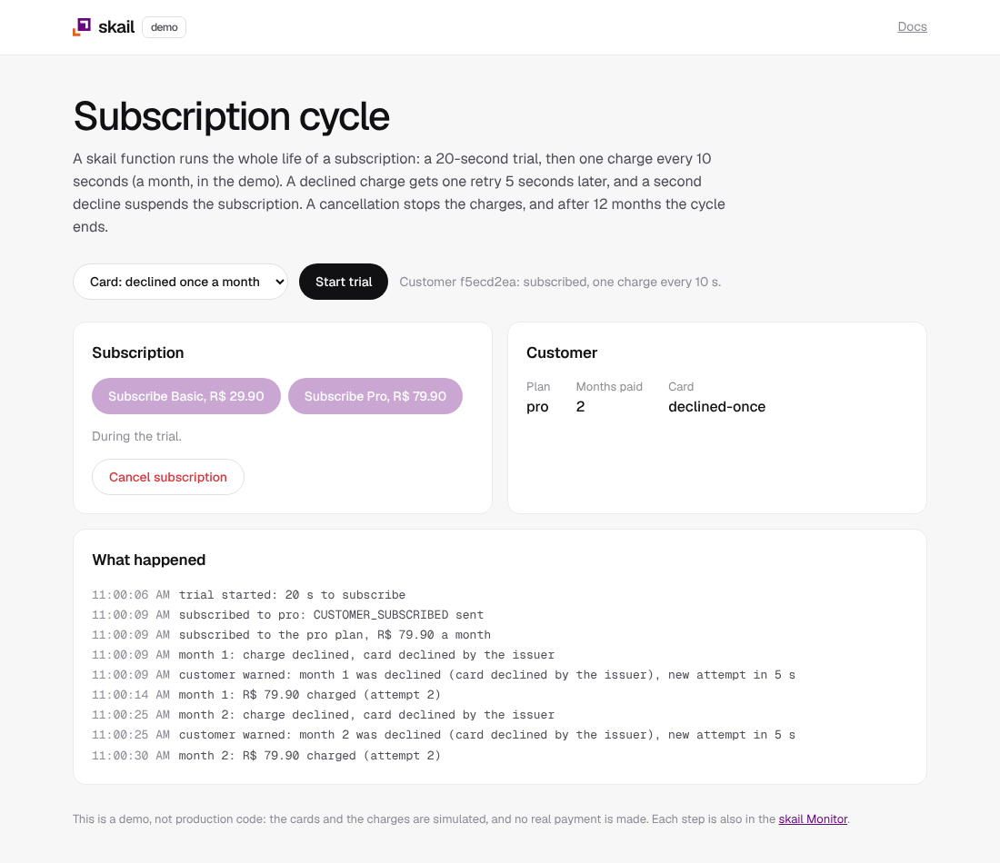

# skail subscription cycle (Node.js)

[English](README.md)

Um app com uma function do skail que roda a vida inteira de uma assinatura. O cliente começa um teste grátis, e a function espera o fim do teste ou a assinatura do cliente, o que vier primeiro. Depois da assinatura, ela cobra o plano uma vez por mês: uma cobrança recusada ganha uma nova tentativa, e uma segunda recusa suspende a assinatura. Um cancelamento para as cobranças, e depois de 12 meses o ciclo termina. O teste dura 20 segundos e o mês 10 segundos aqui; uma assinatura real usa 30 dias e um mês, com o mesmo código. Você faz o papel do cliente numa página que o app serve em http://localhost:8080.

Ele mostra três recursos do skail:

- **cobrança recorrente**: uma assinatura é um laço que cobra e espera o próximo mês;
- a **espera com prazo**: o teste termina no prazo ou quando o cliente assina, o que vier primeiro;
- **hibernação e retomada**: entre as cobranças a execução não ocupa thread nem processo, então você pode fechar o app e os meses continuam contando.

## Requisitos

- Um destes: [Docker](https://docs.docker.com/get-docker/), [Podman](https://podman.io/docs/installation) ou o [Node.js](https://nodejs.org) 20.12 ou mais novo. O script de execução usa o primeiro que encontrar.
- Um environment do skail com um workload registrado para o `SKAIL_WORKLOAD` do `.env` (`subscriptioncycle:v1.0.0` por padrão). O [Quickstart](https://docs.skail.dev/comece-aqui/quickstart) mostra como criar a conta, o environment e o workload.

O projeto usa o `@skail/runtime` e o `@skail/build` **2.0.1-rc4**.

## Rodar

```bash
cp .env.example .env          # preencha SKAIL_SIDECAR, SKAIL_NAMESPACE e SKAIL_KEY (portal > Environments & keys > Connect)
scripts/run.sh                # depois abra http://localhost:8080
```

No Windows, no PowerShell: `copy .env.example .env` e depois `powershell -ExecutionPolicy Bypass -File scripts\run.ps1`, com os mesmos argumentos. O script funciona no Windows PowerShell que já vem no Windows; não precisa do PowerShell 7.

O script roda a demo com o que a máquina tiver: Docker, depois Podman, depois o Node.js. Se não achar nenhum, ele diz o que instalar. Sem o script, os comandos são `npm install`, `npm run build` e `npm start` (com os argumentos depois de `--`, como em `npm start -- <argumento>`).



Cada passo dos commands aparece na página, em **What happened**, e no console. Os botões mandam os eventos para a execução, e a página se atualiza sozinha a cada segundo.

## Os caminhos

| Cartão e o que você clica | O que acontece | Resultado |
|---|---|---|
| **Start trial**, depois nada | o teste termina no prazo e nada é cobrado | `trial ended` |
| `approved`, **Subscribe** | uma cobrança por mês, até o mês 12 | `cycle ended` |
| `approved`, **Subscribe**, depois **Cancel subscription** | as cobranças param, e os meses já pagos continuam pagos | `cancelled` |
| `declined once a month`, **Subscribe** | todo mês a primeira tentativa é recusada, o cliente é avisado e a nova tentativa 5 segundos depois é aprovada | o ciclo continua |
| `always declined`, **Subscribe** | o mês 1 é recusado duas vezes | `suspended` |

Com `declined-once`:

```text
[c914edc4] month 1: charge declined, card declined by the issuer
[c914edc4] customer warned: month 1 was declined (card declined by the issuer), new attempt in 5 s
[c914edc4] month 1: R$ 29.90 charged (attempt 2)
```

## Como funciona

O app faz três coisas no mesmo processo: serve a página, hospeda o worker que executa a function (`createSkailPlatform`, com o bundle gerado pelo `npm run build`) e inicia o cliente com o cartão escolhido e transforma os botões nos eventos de assinatura e de cancelamento, pela API HTTP do skail. Os commands registram cada passo numa linha do tempo que a página mostra (por HTTP local, porque os commands rodam numa VM isolada):

```http
POST {SKAIL_SIDECAR}/api/v1/trigger/subscriptioncycle/v1.0.0/ManageSubscription/{customerId}
["{customerId}", 20, 10]

POST {SKAIL_SIDECAR}/api/v1/fire/CUSTOMER_SUBSCRIBED/{customerId}
{"plan": "pro", "at": "2026-11-18T14:42:05.000Z"}

POST {SKAIL_SIDECAR}/api/v1/fire/SUBSCRIPTION_CANCELLED/{customerId}
{"reason": "cancelled in the demo", "at": "2026-11-18T14:42:38.000Z"}
```

A function, em [`src/subscription-functions.ts`](src/subscription-functions.ts):

```ts
@SkailFunction()
async ManageSubscription(customerId: string, trialSeconds: number, monthSeconds: number): Promise<string> {
  await this.StartTrial(customerId, trialSeconds);

  // whenAny returns the value of the winner: the subscription, or undefined when the trial deadline wins
  const subscription = Skail.waitForEvent<Subscription>(Events.customerSubscribed, customerId);
  const subscribed = await Skail.whenAny([Skail.delaySeconds(trialSeconds), subscription]);
  if (!isEvent<Subscription>(subscribed)) return this.EndTrial(customerId);

  const plan = subscribed.plan;
  await this.StartSubscription(customerId, plan);

  const cancellation = Skail.waitForEvent<Cancellation>(Events.subscriptionCancelled, customerId);

  for (let month = 1; month <= MAX_MONTHS; month++) {
    let charge = await this.ChargeMonthlyFee(customerId, plan, month, 1);
    if (!charge.approved) {
      await this.NotifyPaymentDeclined(customerId, month, charge.reason!);
      await Skail.delaySeconds(RETRY_SECONDS);
      charge = await this.ChargeMonthlyFee(customerId, plan, month, 2);
    }
    if (!charge.approved) return this.SuspendSubscription(customerId, month);

    const winner = await Skail.whenAny([cancellation, Skail.delaySeconds(monthSeconds)]);
    if (isEvent<Cancellation>(winner)) return this.CancelSubscription(customerId, month);
  }

  return this.EndCycle(customerId, MAX_MONTHS);
}
```

- A espera por `SUBSCRIPTION_CANCELLED` é criada uma vez, antes do laço, e reaproveitada todo mês.
- O `whenAny` devolve o valor de quem venceu: o payload do evento, ou `undefined` quando vence um prazo.
- Um cartão recusado é um resultado, não um erro: outra tentativa no mesmo segundo teria a mesma resposta, então a function espera 5 segundos e tenta mais uma vez.
- O `ChargeMonthlyFee` recebe o mês e a tentativa, e a rede de cartões simulada responde só pelo cartão e pela tentativa, então uma nova tentativa técnica do command não cobra o mês duas vezes.
- A function recebe só o id do cliente e as durações. O cartão fica no app, guardado por cliente como um gateway de pagamento guarda o cartão, e o command de cobrança lê dali, então ele nunca entra no histórico da execução nem no Monitor.

| Arquivo | O que tem |
|---|---|
| `src/subscription-functions.ts` | A function e os commands dela. |
| `src/model.ts` | Os planos, os nomes dos eventos, os cartões simulados e os payloads dos eventos. |
| `src/main.ts` | Lê o `.env` e o argumento, serve a página e a API dela e hospeda o worker. |
| `src/subscription-desk.ts` | Inicia o cliente e transforma cada botão num evento; guarda o cartão do cliente. |
| `src/timeline.ts` | A linha do tempo dos passos, para o console e a página. |
| `page/index.html` | A página, com o branding do skail. |
| `src/skail-api.ts` | Trigger e fire pela API HTTP do skail. |
| `src/skail-functions.ts` | Ponto de entrada do bundle do skail. |
| `scripts/build-skail.mjs` | Gera o bundle em `.skail/` para o `SKAIL_WORKLOAD`; rode `npm run build` de novo se ele mudar. |
| `scripts/run.sh`, `scripts/run.ps1`, `Dockerfile` | Rodam a demo com Docker, Podman ou o Node.js, o que houver na máquina. |

## Veja a durabilidade

1. Rode `scripts/run.sh`, abra a página, comece um teste, assine e espere o `month 1: ... charged`.
2. Aperte **Ctrl+C**. O app fecha; a assinatura continua no skail, esperando o próximo mês.
3. Espere alguns segundos e abra o app de novo com o id do cliente que aparece na página e no console, e o mesmo cartão: `scripts/run.sh <id do cliente> approved`. Com um id, o app não inicia outro cliente: só hospeda o worker de novo e acompanha esse cliente.
4. O mês que venceu com o app fechado é cobrado na hora, e os próximos mantêm o ritmo de 10 segundos. Clique em **Cancel subscription** para parar.

No portal, abra o [Monitor](https://docs.skail.dev/referencia/portal/monitor) do seu environment e clique na execução: cada mês aparece como `ChargeMonthlyFee` seguido de um `WhenAny` com o seu `Delay`. Compare **Duration** com **E2E Duration**: as esperas não ocupam o worker.

## Observações

- A execução tem um limite de 12 meses. Cancele as assinaturas que você iniciar, para elas não ficarem rodando no seu environment.
- Apps rodando o mesmo `SKAIL_WORKLOAD` no mesmo environment dividem as mesmas execuções: use um workload (ou environment) por pessoa.

## Aviso

**Esta é uma demonstração, não é código de produção.** Ela existe só para mostrar como o [skail](https://docs.skail.dev) funciona e é fornecida "como está", sem garantia de nenhum tipo. Os cartões e as cobranças são simulados: nenhum pagamento real é feito.

## Licença

[Apache-2.0](LICENSE)
